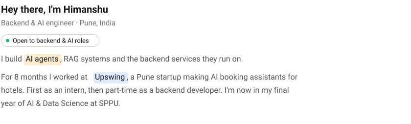
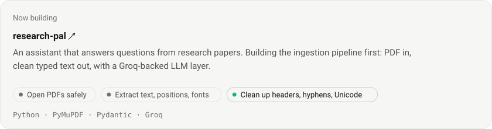
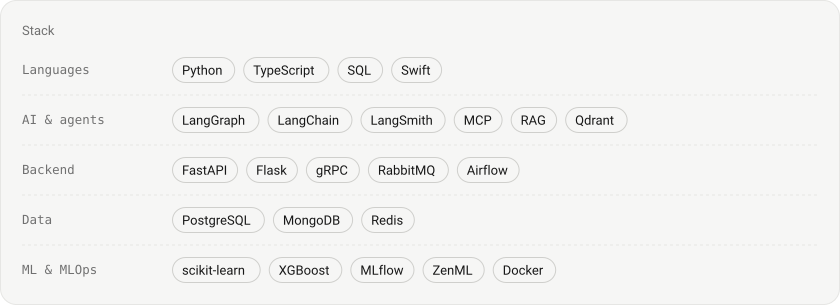
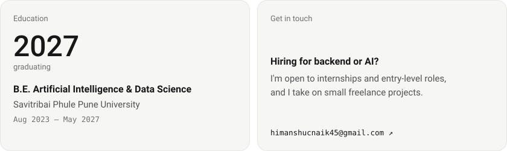

<!-- Cards are generated by scripts/build_cards.py. Edit the DATA section there and rerun it. -->

<picture>
  <source media="(prefers-color-scheme: dark)" srcset="assets/intro-dark.svg">
  
</picture>

[**Resume ↗**](https://www.himanshunaik.dev/Himanshu_Naik_Resume.pdf) &nbsp;·&nbsp; [Website ↗](https://www.himanshunaik.dev) &nbsp;·&nbsp; [LinkedIn ↗](https://www.linkedin.com/in/himanshu-45naik) &nbsp;·&nbsp; [Email ↗](mailto:himanshucnaik45@gmail.com)

<a href="https://www.upswing.cloud/">
<picture>
  <source media="(prefers-color-scheme: dark)" srcset="assets/work-dark.svg">
  
</picture>
</a>

<a href="https://github.com/himanshu-45naik/research-pal">
<picture>
  <source media="(prefers-color-scheme: dark)" srcset="assets/now-dark.svg">
  
</picture>
</a>

<picture>
  <source media="(prefers-color-scheme: dark)" srcset="assets/projects-dark.svg">
  
</picture>

[AI Feedback System](https://github.com/himanshu-45naik/ai-feedback-system) &nbsp;·&nbsp; [Shared Object](https://github.com/himanshu-45naik/sharedObj) ([demo](https://www.loom.com/share/9637251a74ee402a849cc18f5008072b)) &nbsp;·&nbsp; [Parchi](https://github.com/himanshu-45naik/parchi) ([download](https://github.com/himanshu-45naik/parchi/releases/latest/download/Parchi.dmg)) &nbsp;·&nbsp; [Network Intrusion Detection](https://github.com/himanshu-45naik/Network-intrusion-detection) ([live](https://nids-api-bibt.onrender.com)) &nbsp;·&nbsp; [Waste Watch Campus](https://github.com/himanshu-45naik/Waste-Watch-Campus)

<picture>
  <source media="(prefers-color-scheme: dark)" srcset="assets/stack-dark.svg">
  
</picture>

<a href="mailto:himanshucnaik45@gmail.com">
<picture>
  <source media="(prefers-color-scheme: dark)" srcset="assets/edu-contact-dark.svg">
  
</picture>
</a>
